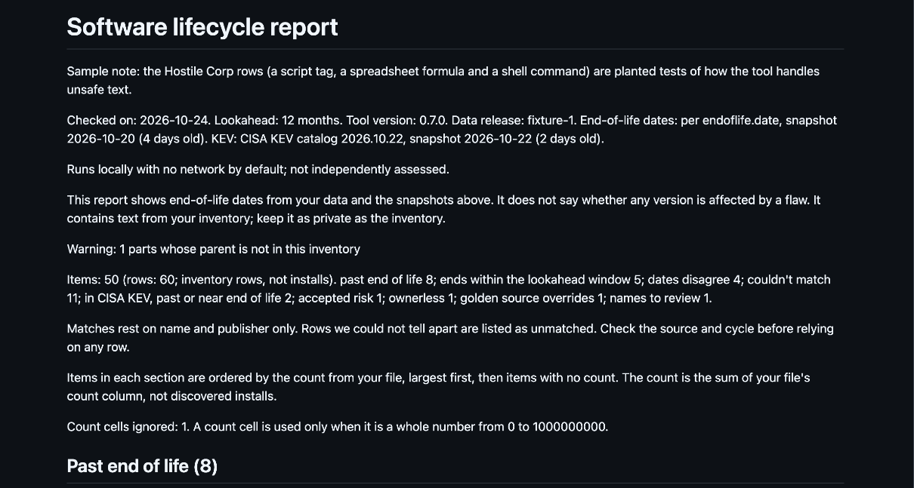
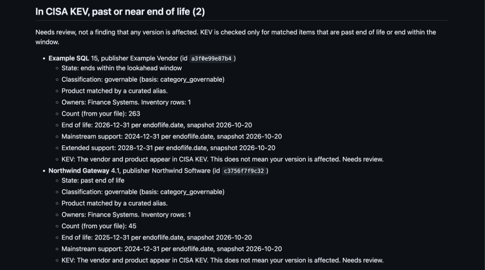

# software-lifecycle

[](https://github.com/evemcgivern/software-lifecycle/actions/workflows/ci.yml)
[](https://github.com/evemcgivern/software-lifecycle/releases)
[](LICENSE)
[](#install)
[](#install)
[](#maintaining)

`software_lifecycle.py` reads a software inventory export and lists what is
past end of life or close to it. It also flags items whose vendor and
product appear in CISA's Known Exploited Vulnerabilities (KEV) catalog, so a
person can review them first.

Runs locally with no network by default; not independently assessed.

## Who built this and why

I'm Eve McGivern. I run IT application governance for a large global
company: the application register, owner assignment, quarterly application
audits, and the evaluation of IT service management and IT asset management
tools. I started in technical business analysis.

Lifecycle tracking is harder than it looks. Export names rarely match the
names vendors publish. End-of-life dates sit on vendor pages in different
formats. One product has many release lines, each with its own date, and a
date means nothing until you match the right one. A quarterly review also
needs evidence, not a guess. Commercial catalogs solve this, but not every
team has one, and many inventories can't leave the building. I built this
for those teams: offline, plain files, and honest about what it can't match.

## Start here

Pick the row that fits you.

| I want to... | Go to |
|---|---|
| Have an AI assistant run it for me (Claude Code, Codex, ChatGPT desktop app, GitHub Copilot, or a chat assistant that guides me) | [docs/assistant-setup.md](docs/assistant-setup.md) |
| Let Claude Desktop or the ChatGPT desktop app run only the counts, through a small local server (optional, advanced; tested once on one Mac, with parts Unverified; use the full path to Python; a one-click package was installed and run once on one Mac, the rest Unverified) | [docs/mcp-setup.md](docs/mcp-setup.md) |
| Run it myself in a terminal | [docs/quick-start.md](docs/quick-start.md) |
| Understand a report as an analyst or consultant | [examples/sample-report.md](examples/sample-report.md) shows a report. [docs/glossary.md](docs/glossary.md) explains the words. [docs/usage.md](docs/usage.md) has the details. [docs/sop.md](docs/sop.md) and [docs/checklist.md](docs/checklist.md) cover the quarterly review. |
| Export from Flexera, ServiceNow or Rapid7 | [docs/platform-guide.md](docs/platform-guide.md) |
| Contribute | [CONTRIBUTING.md](CONTRIBUTING.md). Report a security problem through [SECURITY.md](SECURITY.md). |

Real inventories are confidential. Whoever runs the tool, read "Privacy and
security" below first.

## Who this is for

- Teams that have an inventory export but no commercial software catalog.
- Security and platform teams that use `--fail-on` as an offline gate.
- One-off reviews of an estate.

When not to use it: if you already run Flexera, ServiceNow or Rapid7, you
likely have a wider catalog. This tool covers only the products
endoflife.date lists. Dates come from endoflife.date unless a golden-sources
file overrides them.

## Terms in plain language

Open a term to read it.

<details>
<summary><strong>What is KEV?</strong></summary>

KEV is the Known Exploited Vulnerabilities catalog, a list kept by CISA, the
US government's cybersecurity agency. Each entry is a software flaw (a CVE)
that CISA has evidence attackers have used in real attacks, with the vendor
and product it affects.

KEV lists flaws CISA has such evidence for. It is not a complete list of
every flaw attackers use. A product on it is a reason to review that item
first.

What KEV does not tell you:

- It is not a list of every flawed product.
- It is not a severity score.
- It does not say whether your version has the flaw.

This tool uses it as a pointer to where a person should look first. It
checks your inventory's vendor and product against KEV, and it raises the
flag only for items that are also past or near end of life. It never checks
versions, so a match means "needs review" and nothing more. The same goes
the other way: `kev: false` means no match under the tool's rules, not that
the software is known safe. The catalog is at
<https://www.cisa.gov/known-exploited-vulnerabilities-catalog>. See
"KEV limits" below for the exact rules.

</details>

<details>
<summary><strong>What is an SBOM?</strong></summary>

An SBOM is a software bill of materials: a list of the parts inside one
piece of software, such as each component's name, version and licence. Think
of the ingredients label on food. The common formats are CycloneDX and SPDX.

An SBOM and the inventory this tool reads are different things:

- An SBOM lists what is inside one product.
- An inventory export lists what is installed across an estate.

This tool does not read SBOM files. Its input is a CSV inventory export.

The tool has an SBOM of its own. Each CI run on a pull request or a push to
`main` writes a CycloneDX 1.5 SBOM and uploads it as a build artifact named
`sbom`. It lists the tool itself and no third-party components, because the
tool uses only the Python standard library. It is not attached to releases,
and it is not independently assessed.

</details>

<details>
<summary><strong>What is end of life?</strong></summary>

End of life (EOL) is the date after which a vendor or project stops
publishing fixes for a version. Software past that date gets no more
security updates from its maker. Some vendors sell extended support beyond
it. A support record you hold for that is shown beside the vendor's dates
but never changes a state, a list or `--fail-on`; see "Override files"
below.

</details>

<details>
<summary><strong>What is a cycle?</strong></summary>

A cycle is one release line of a product that has its own end-of-life date,
for example Python 3.12 or Ubuntu 22.04. The tool matches a name and version
to a product and a cycle. If it cannot decide on a cycle, it claims no date
and the item lands in "couldn't match".

</details>

<details>
<summary><strong>What is a CVE?</strong></summary>

A CVE is a public ID for one specific software flaw, such as
CVE-2021-44228. KEV entries are CVEs. This tool does not look up CVEs or
score their severity. It is not a scanner.

</details>

<details>
<summary><strong>What is endoflife.date?</strong></summary>

endoflife.date is a public website, with MIT-licensed product files, that
lists end-of-life dates by product and cycle. The tool's dates come from it
unless a golden-sources file overrides them. See "Data and release
verification" below.

</details>

<details>
<summary><strong>What is an item ID?</strong></summary>

An item ID is a 12-character hash of publisher, name and version. It keeps
names out of counts and findings, but it does not hide an item from someone
who can guess it. Treat item IDs with the same care as the inventory. See
"Privacy and security" below.

</details>

<details>
<summary><strong>What is counts-only mode?</strong></summary>

`--counts-only` makes the tool print only counts, item IDs, the checked-on
date and the `kev_current` flag. The full report goes to a file. It is meant
for running the tool through an AI assistant. The assistant can still read
that file, so tell it not to. See "Privacy and security" below.

</details>

## Install

There is nothing to install. You need Python 3.9 or newer and nothing else,
because the tool uses only the standard library. Clone the repo or download
a release, then run the commands below from the repo root with
`python3 software_lifecycle.py` (on Windows, `py`).

## Quick start

For a step-by-step page for macOS, Linux and Windows, use
[docs/quick-start.md](docs/quick-start.md). To have an AI assistant run it,
use [docs/assistant-setup.md](docs/assistant-setup.md).

Run these from the repo root.

1. Try the demo. The demo inventory is made up and runs against synthetic
   data, so the output never changes with the date:

   ```bash
   python3 software_lifecycle.py check examples/software-inventory.csv --data tests/fixtures/data --as-of 2026-10-24 --golden examples/golden-sources.csv --exceptions examples/exceptions.csv --tracking examples/tracking.csv --support-records examples/support-records.csv --out ../swlc-demo
   ```

2. Open `../swlc-demo/report.md`. `report.json` and `report.csv` are in
   the same folder.
3. Check your own inventory against the bundled real data. Read "Privacy
   and security" below first, because real inventories are confidential:

   ```bash
   python3 software_lifecycle.py check YOUR-INVENTORY.csv --out ../swlc-out
   ```

If you run the demo inventory against the bundled data, every item lists as
"couldn't match", because the demo names are made up.

### What the demo shows

The tool prints one line and writes three files:

```text
Wrote report.json, report.md, report.csv to ../swlc-demo
```

The summary line at the top of `report.md` gives one count for each list:



The section for items whose vendor and product appear in CISA KEV lists two
sample items:



Both images are the sample report as GitHub renders `report.md`. The full
text is in [examples/sample-report.md](examples/sample-report.md).

Before the first check of a new export, run `preflight`. It says which
columns it found and what to fix, without printing any row:

```bash
python3 software_lifecycle.py preflight YOUR-INVENTORY.csv
```

All commands and flags are in [docs/usage.md](docs/usage.md).

## What you get

The report has these lists. An item can be on more than one.

- **Past end of life.**
- **Ends within the lookahead window.** The window is 12 months unless you
  change it.
- **Dates disagree.** This covers three cases: the export's own date and the
  endoflife.date date differ; a golden source has expired; or a golden
  source says to use the export date and the export has no usable one
  (`GOLDEN_EXPORT_UNUSABLE`).
- **Couldn't match.** The name and version did not map to a known product
  and cycle, and the tool claims no date for these. Some names it refused on
  purpose: a product title on a row with no publisher, or a row whose name
  and version fit more than one support line, such as Internet Explorer 11.
  Those are listed again under "Names to review". They are not a finding.
- **In CISA KEV, past or near end of life.** The item is past or near end of
  life, and its vendor and product appear in CISA KEV. The wording is "needs
  review". KEV matches vendor and product only, never version. The tool
  never says "vulnerable". The report prints this line: The vendor and product appear in CISA KEV. This does not mean your version is affected.
- **Accepted risk.** The item is listed in your exceptions file.
- **Ownerless.** The export has no owner for the item.
- **Golden overrides.** The item's state changed because a golden source
  chose a different date. A golden source that changes the date but not the
  state is not listed.

The report files are `report.json`, `report.md` and `report.csv`. Their
fields are in [docs/report-schema.md](docs/report-schema.md).

### What a report looks like

[examples/sample-report.md](examples/sample-report.md) is the `report.md`
the demo run above writes, from made-up data only. A test keeps it the
same as the real output. [docs/glossary.md](docs/glossary.md) explains the
words it uses.

## Privacy and security

The claims line at the top of this file is the whole claim. Nothing here
goes beyond it.

- Real inventories are Confidential. Run them only through the local
  script, or through an AI agent in `--counts-only` mode. To set up an
  agent, see [docs/assistant-setup.md](docs/assistant-setup.md).
- In `--counts-only` mode the tool prints only counts, item IDs, the
  checked-on date and the `kev_current` flag. The full report goes to a
  file. An agent can still read that file, and nothing technical stops it.
  Tell the agent not to, and keep the output folder out of its reach.
- The optional MCP server (`swlc_mcp.py`) for desktop chat apps enforces
  counts-only in its code: it returns only fixed labels and numbers, with
  no item IDs. It was tested by hand once, on one Mac, in both apps
  (2026-11-01). What is and is not tested, and what it does not protect, is
  in [docs/mcp-setup.md](docs/mcp-setup.md).
- An item ID is a 12-character hash of publisher, name and version, with
  no secret in it. It keeps names out of counts and findings. But anyone
  who holds a guess ("publisher, name, version") can hash it and confirm
  that the item is in the estate. Treat item IDs with the same care as
  the inventory, and do not post them where the inventory would not go.
- No model should read the full report. Letting an AI read the CSV
  directly is not a mode of the tool. Do it only with synthetic or
  non-sensitive inventories.
- The default keeps no run history. Keeping evidence is your choice. See
  [docs/sop.md](docs/sop.md).
- The tool prints roles (asset owner, risk owner, approver, ITAM lead). It
  never assigns people.
- Details of the supply chain are in [SECURITY.md](SECURITY.md), which also
  says how to report a security problem.

CISA's current binding directive for US federal civilian agencies, BOD 26-04, superseded BOD 22-01 (source:
<https://www.cisa.gov/news-events/directives/bod-26-04-prioritizing-security-updates-based-risk>).
It is a reference only. It binds federal civilian agencies only. This tool
does not implement it or its deadlines.

## Your input file

The file is a CSV with a header row. Two columns are required. The tool
matches headings after ignoring case, punctuation and spacing, and it never
guesses.

| Field | Headings it accepts |
|---|---|
| name (required) | name, software name, software, product, product name, display name, application, application name, app name, title |
| version (required) | version, software version, product version, display version, app version, release, build |
| publisher | publisher, vendor, manufacturer, software publisher, software vendor, company |
| owner | owner, assigned to, business owner, technical owner, application owner, managed by, contact, owned by |
| count | count, install count, installs, installations, installed count, number of installs, quantity, qty, instances, device count |
| export_eol | export eol, end of life, eol, eol date, end of life date, end of life eol |
| export_support | export support, end of support, eos, end of support date, support end date, support end |
| parent | parent, parent software, suite, bundle |

If a required heading is missing, the tool stops and names the field. If
two columns map to one field, it stops too. `--columns FILE` adds your own
headings; see `templates/columns.example.json`. A blank layout is in
`templates/inventory-template.csv`.

A few columns need a note:

- **`parent`** is optional. It names the row's parent software, such as the
  suite a part belongs to. A blank or placeholder cell (`n/a`, `none`)
  means no parent. See "The Parent column" in
  [docs/usage.md](docs/usage.md).
- **`export_support`** is accepted but not used in this version.
- **`count`** orders each list, largest first. An item's count is the sum of
  its rows' count cells. It is a count from your file, not discovered
  installs; see "The count column" in [docs/usage.md](docs/usage.md).
  `rows` in the report counts inventory rows, not installs or machines.
  `report.md` says so in its summary line and labels each item's count
  "Inventory rows".

Export dates must be ISO dates (`2026-01-15`, optionally with a time).
Day-first and month-first dates are never read. For a matched item with no
active golden source, an unreadable export date puts the item on "dates
disagree".

### Profiles

`--profile` picks a pre-filled list of extra headings for an export source.
The profiles `flexera`, `servicenow-mbs` and `rapid7` are read from
`data/profiles.json`. All three are marked **Unverified**: no one has run
them on a real export yet. The report says so when you use one. See
[docs/platform-guide.md](docs/platform-guide.md).

## Override files

You own these files. The tool never changes them.

- **`golden-sources.csv`** says which date is right for a product (the
  endoflife.date date, the export's date, or a manual date) and when to
  review that choice.
- **`exceptions.csv`** records accepted risk: compensating controls, a risk
  owner, an approver who is not the requester, an expiry date and a
  reference.
- **`tracking.csv`** links a finding's item ID to a change reference and a
  problem reference.
- **`support-records.csv`** lists the support records you hold: your
  reference, an endoflife.date product ID, an optional cycle, a kind such
  as extended support, and an end date. The report shows them beside the
  vendor's dates. It also lists records that end within the window or name
  no dated item in this inventory. It is a lifecycle and renewal aid, not
  a licence or audit position. The tool does not check that a record was
  paid for or is current, and a record never changes a state, a list or
  `--fail-on`. See "Support records" in [docs/usage.md](docs/usage.md).

Blank copies are in `templates/`. The column rules are in
[docs/report-schema.md](docs/report-schema.md). The quarterly process is in
[docs/sop.md](docs/sop.md).

## Data and release verification

The bundled data holds end-of-life dates from the endoflife.date product
files and the CISA Known Exploited Vulnerabilities catalog. Its release ID,
upstream commit, snapshot dates and catalog version are in
`data/manifest.json`. Read them there; they change when a new data release
is merged.

How often the data updates:

| Data | Schedule | What happens |
|---|---|---|
| CISA KEV | Daily, 07:41 UTC | A new data release is published when the data changed. |
| End-of-life dates (endoflife.date) | Weekly, Mondays 08:23 UTC | The job opens a pull request. The dates reach users in the next daily release after the maintainer merges it. |

These are the scheduled times. The project is maintained as time allows, so
a run can be late, and GitHub can pause scheduled jobs (see "Maintaining"
below). Check the snapshot dates in `data/manifest.json` to see how old
your copy is.

- `data/eol/*.json` derive from endoflife.date product files (MIT).
  Product descriptions are not included. See THIRD-PARTY.md for the
  attribution and licence text.
- `data/products.json` derives from the same endoflife.date product files:
  product id, title, category, CPE vendor names and package owner names
  only. `data/curation.json` is a hand-kept file of maintainer decisions.
  See "The data folder" in [docs/usage.md](docs/usage.md).
- `data/kev.json` derives from the CISA Known Exploited Vulnerabilities
  catalog (CC0 1.0), https://www.cisa.gov/known-exploited-vulnerabilities-catalog.

Staleness rules:

- A KEV snapshot older than 3 days gives a warning. Older than 7 days, the
  KEV overlay is reported as "not current".
- An end-of-life snapshot older than 30 days gives a warning.

The bundled data is a snapshot. The KEV job runs daily and publishes a data release when the data changed.
The weekly end-of-life job opens a pull request, and the next daily release
carries the dates once it is merged. Point `--data` at any
directory that holds a verified data release to use one.

The tool checks a SHA-256 manifest every time it loads data
(`verify-data` runs only that check). That catches a damaged data folder.
It does not prove who made the files. The tool never claims to verify
attestations offline. Data releases made while the repository is public
carry a GitHub artifact attestation. Check it online before you use the
release:

```bash
gh attestation verify data.zip --repo evemcgivern/software-lifecycle --signer-workflow evemcgivern/software-lifecycle/.github/workflows/kev-daily.yml --source-ref refs/heads/main
```

## How it can be wrong

### Coverage

- Coverage is partial. In the data release bundled when this was written
  (the weekly job can change the counts), the tool can match 452 of the 485
  products in `data/eol/`. Most are matched by the product's title from endoflife.date
  (`data/products.json`). `data/aliases.json` adds 155 aliases for
  24 products (mssqlserver, windows-server, windows, office,
  python, nodejs, ubuntu, eclipse-temurin, windows-powershell, mysql,
  bellsoft-liberica, msexchange, sharepoint, visual-studio, dotnet,
  dotnetfx, debian, macos, sles, powershell, rhel, rocky-linux,
  almalinux, oracle-linux). `data/curation.json` adds hand-kept vendor names for
  72 products and a short list of one-word product names. A further list
  of coined one-word titles matches a row with no publisher when the name
  carries a version that decides the cycle (`Kibana 8.15.3`). The other 33
  products are devices, products left out on purpose, or one-word titles
  with no vendor to check, and never match.
- That is a count of products, not a hit rate. On the project's own
  benchmark (the 2,025 hand-written and catalog rows in
  `tests/benchmark/gold.csv`), 1,035 rows should match a product. 751 of them
  are scored correct: 597 with the right cycle, and 154 rightly with the
  product and no cycle. Of the 867 rows that need a cycle, 597 get one. The other 990 rows are
  traps that should stay unmatched, and all 990 do. It is a benchmark, not a
  real estate. The rate on a real estate is unknown.
- No wrong lifecycle claim was found on the benchmark. That is not proof for
  other inventories: unknown in general.
- Software with no lifecycle policy, for example git, curl and vim, is
  outside the data and will never match. Long "couldn't match" lists will
  remain. That is safer than a wrong guess. A golden source does not apply
  to an unmatched item.
- To add your own aliases, see "Extending the alias table" in
  [docs/usage.md](docs/usage.md). The maintainer extends the bundled data
  from "couldn't match" reports; the issue form takes names only.

### Matching limits

- Build numbers versus cycles: a product whose version is a build number
  may map to the wrong cycle or none. Check the cycle shown in the report.
- Names must match strictly. A name with extra words after the product name
  often lands in "couldn't match". That is safer than a wrong guess.
- SQL Server 2016 and older are unmatched in this version, because
  endoflife.date lists service-pack cycles for them.
- Java 8 names that carry an update number are unmatched.
- `windows-server` and the Windows client aliases use the broad
  Microsoft and Windows KEV pair, because CISA files Windows flaws under
  the product Windows. Every Windows entry matches.
- Windows 10 names with extra words, such as "Windows 10 Enterprise 22H2",
  land on NO_ALIAS. Windows 11 matches by edition name (Home, Pro, Pro
  Education, Pro for Workstations, Education, Enterprise); Windows 11
  LTSC 2024 and IoT names stay unmatched.

### KEV limits

- KEV matches vendor and product only, never version. A match means "needs
  review", not "your version is affected".
- KEV is checked through the alias table's vendor and product pairs for
  matched products. For a product matched by name but without such a pair,
  the tool compares the publisher and the full inventory name (version
  included) with KEV, exactly. So `kev: false` means "no match under those
  rules". It does not mean the software is known safe.

### Data and platform

- The profiles are Unverified until run on a real export.
- Data is a snapshot and can be out of date.
- CI runs the tests on Python 3.9 to 3.13. The tool was tested on macOS
  and Linux. The test suite also runs on Windows (Python 3.12) in an
  informational CI job, with a few POSIX-only checks skipped. The
  quick-start paths and the `python3` command assume Unix; on Windows use
  `py` or `python`. A Windows export with CRLF line endings reads the
  same as an LF one. Windows is not a supported platform yet: no one has
  run the tool on a real Windows export.

## Maintaining

This is an experiment with a review date of 2027-01-31; on that date the
maintainer decides whether to keep it, archive it, or fold it into another
project. Maintained as time allows, best effort, no SLA, not independently assessed.

- GitHub turns off scheduled workflows in a public repository after
  60 days with no repository activity. Tags and releases may not count as
  activity, so the daily data releases alone may not keep the schedules
  on. If the daily or weekly job stops, turn it back on in the Actions tab
  or push a commit.
- The CI test matrix runs on `ubuntu-24.04`, pinned so the Python 3.9 leg
  keeps working. Python 3.9 is past end of life upstream; drop it from the
  matrix when that runner image stops offering it.

Already set up (as of 2026-10-25):

- The `data-release` environment exists, limited to main.
- The label `alias-request` exists. The "Product the tool could not match"
  issue form applies it.
- The label `eol-weekly-failed` is used by the weekly job's failure report
  (one issue, opened or updated when the weekly update stops). Create it
  once by hand; the job also creates it if it is missing.

The go-public day checklist is in
[docs/maintaining.md](docs/maintaining.md).

Run the tests from the repo root:

```bash
python3 -B -m unittest discover -s tests
```

## Contributing

See [CONTRIBUTING.md](CONTRIBUTING.md) for the full rules, and
[SECURITY.md](SECURITY.md) for how to report a security problem. Agents
read [AGENTS.md](AGENTS.md).

If a product lands in "couldn't match", open the "Product the tool could not
match" issue form. Give the public product name, the publisher and the
version format. Names only: never paste inventory rows, owner names or
reports into a public issue.

Other forms: a test of an assistant or the MCP server, a column-name
problem with an export (headers only), and a mistake in the docs.

The crosswalk to standards is in `docs/crosswalk.csv`; how to read it is in
[docs/themes.md](docs/themes.md).

## Licence

MIT. See LICENSE. Third-party material: THIRD-PARTY.md.
